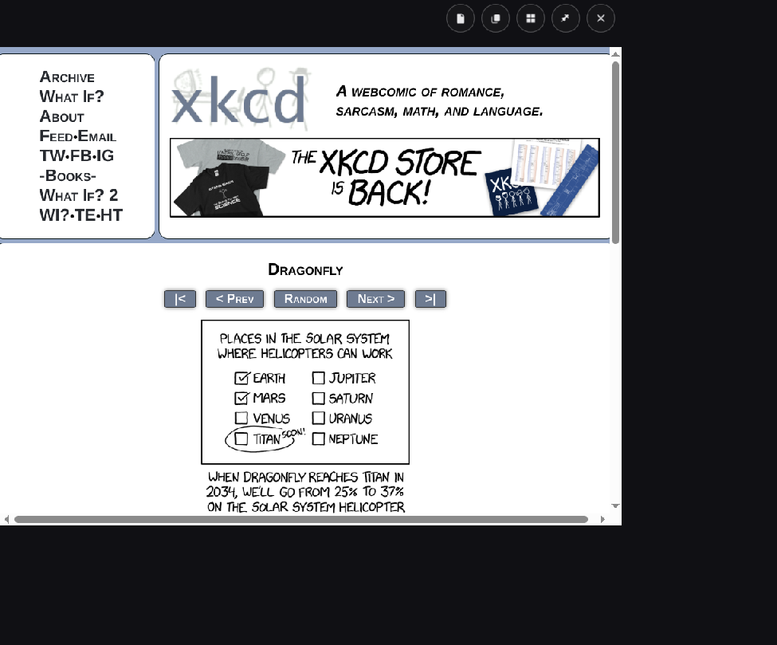

# pique

**The peek browser for Omarchy: look at a link without paying for it with a tab.**

Arc's best idea wasn't Spaces or the sidebar — it was Peek: links you're not
sure about open as a quick preview, and you either close them or keep them.
pique brings that to Hyprland as one small floating window:

- **Ephemeral** — off-the-record profile: no history, no cookies on disk.
  Close the window and the peek never happened.
- **Summonable** — every `pique <url>` opens its own window. A peek that is already open stays as it is.

## Install

On Omarchy (or any Arch system with Hyprland):

    omarchy pkg aur add pique

The package adds the two peek binds to your Hyprland config, a float rule, and the
browser extension for Brave and Chromium (restart the browser once). Remove it with
`sudo pacman -R pique`; that takes the binds, the rule and the extension out again.

## Usage

    pique example.com
    pique "how far is the moon"     # becomes a DuckDuckGo search
    pique                           # opens an empty peek
    pique --prefill="some text"     # empty peek with that text in the search bar
    pique --standby                 # start hidden and wait (see below)
    pique --stop-standby            # make the waiting one quit

## Omarchy setup

`bin/install` adds the binds below to your Hyprland config, and `sudo pacman -R pique` removes them:

| Key | Action |
| --- | --- |
| `Super+Shift+L` | Peek the link under the pointer, else the text selected right now: an address opens, other text waits in the search bar (Enter searches it). Nothing: an empty search bar |
| `Super+Shift+click` | Same as Super+Shift+L |
| `Alt+Shift+click` on a link, in Brave or Chromium | Peek that link |

The two Super chords are the defaults. Change them in `~/.config/pique/shortcuts`, then run `pique-hypr install`. A package upgrade keeps that file.

"Selected right now" depends on where the pointer is:

- **Brave and Chromium, and pique itself** answer from their own page. pique-peek sends the window a spare key (key code 196, F18 to a page) that nothing uses, and the page reports the link under the pointer or its current selection. For browsers this is a small extension, installed for whichever of Brave and Chromium is present; restart the browser once after installing. Alt+Shift+click on a link also works, straight from the page. The extension sends nothing at any other time.
- **Apps on the accessibility bus** (GTK and Qt apps, such as omawrite) are asked for the link at the pointer and their current selection.
- **Everything else** (terminals): what you highlighted in that window. Wayland has only one highlighted-text buffer: it keeps text after you unhighlight it, and a highlight in another window replaces it, even though the first window still shows its own. So a small watcher (`pique-watch`, a few hundred lines of C using about 150 kB, started by the Hyprland block) keeps the last highlight of each window, and a plain click in a window (the click that unhighlights) forgets that window's. Peek over any window that still shows a highlight and you get that text; after you click it away the peek is empty. The text stays in the watcher's memory only (at most 32 windows); just the window addresses are written out (`$XDG_RUNTIME_DIR/pique-primary`, for the click hook).

The peek floats. Wayland windows can't float themselves, so the install also adds a float rule for the `pique` window class. Hyprland centers new floats.

Five icons float just above the window, in this order: reader mode, copy the URL, open it in your browser (and close the peek), tile the window into the workspace, and close it. They follow the window to other workspaces and when it is pinned (Hyprland's own pin), and hide while a video is fullscreen. Inside the peek, Ctrl+W closes it, Esc closes an empty one, and Esc leaves a fullscreen video.

Links that ask for a new tab open in the peek itself.

**Opening at once.** Starting pique (Qt, QML and the web engine) takes about a second, so one copy always waits hidden and already started (`pique --standby`, no CPU). It waits with only Qt and its window ready, and after a few seconds asks the kernel to swap itself out: with zram that is about 8 MB of RAM, and waking reads it back in milliseconds (without swap it stays at about 31 MB). The web engine starts when it is woken, right after the window appears, which keeps the waiting copy small and adds about 0.1 s before a link's page loads. The Hyprland block starts it; a peek hands it the address or text over `$XDG_RUNTIME_DIR/pique-standby` (private to you), it shows its window in under 0.1 s, and then starts the next spare (also when the peek is closed sooner). Without a spare (just after login, or two peeks at once) a peek simply starts the slow way. An upgrade or removal makes the waiting spare quit; open peeks stay.

## Building

    bin/build     # qmake6 + make into build/pique
    bin/test      # offscreen Qt Test run
    bin/install   # makepkg -fsi, launcher entry, and the two peek keybinds

## Notes

- Nothing is persisted, on purpose. A peek is a peek.
- No Widevine: DRM video (Netflix and friends) won't play. Read, don't binge.
- Some sites refuse non-Chrome browsers; QtWebEngine occasionally gets
  blocked by Google sign-in.
- NVIDIA trouble (blank pages, renderer crashes)? Try
  `QTWEBENGINE_CHROMIUM_FLAGS="--disable-gpu" pique <url>`.
- Danish is a draft translation (`src/i18n/da.json`); corrections welcome.

## License

MIT. `src/theme.*` and `src/translator.*` are derived from
[Omacut](https://github.com/omacom-io/omacut) and
[Monologue](https://github.com/omacom/monologue) (MIT, David Heinemeier
Hansson).
